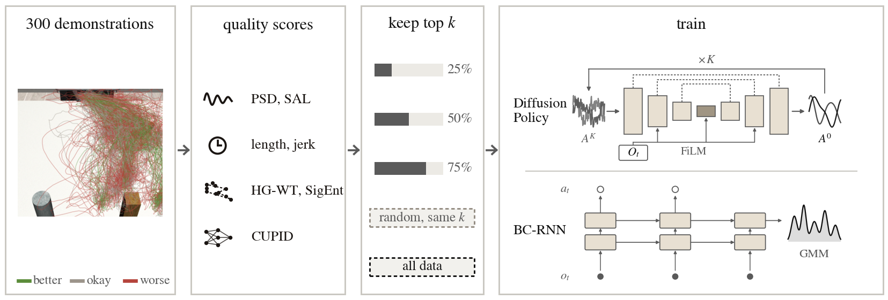
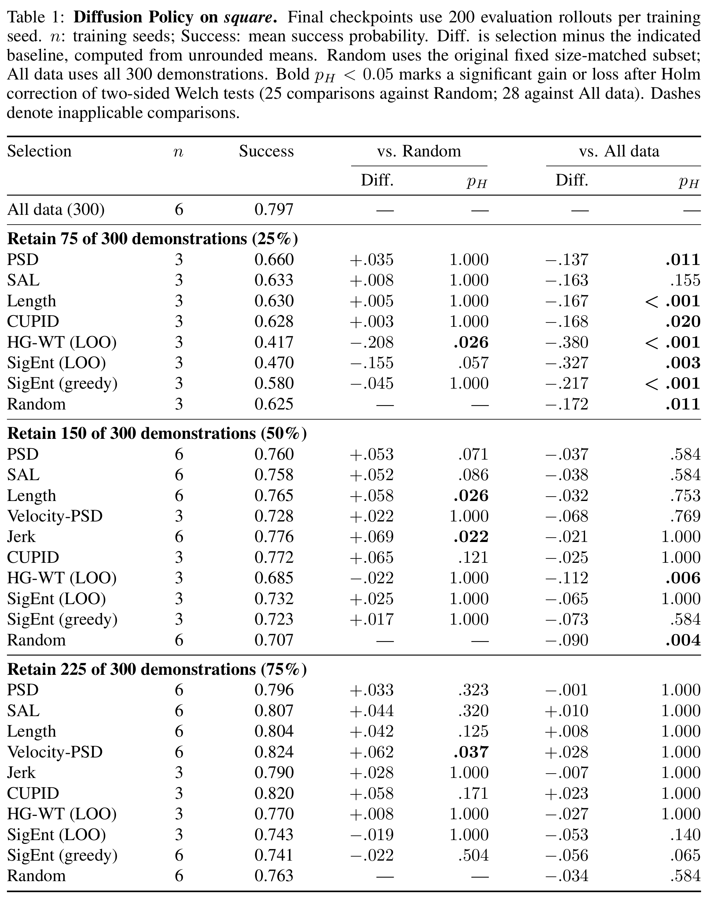
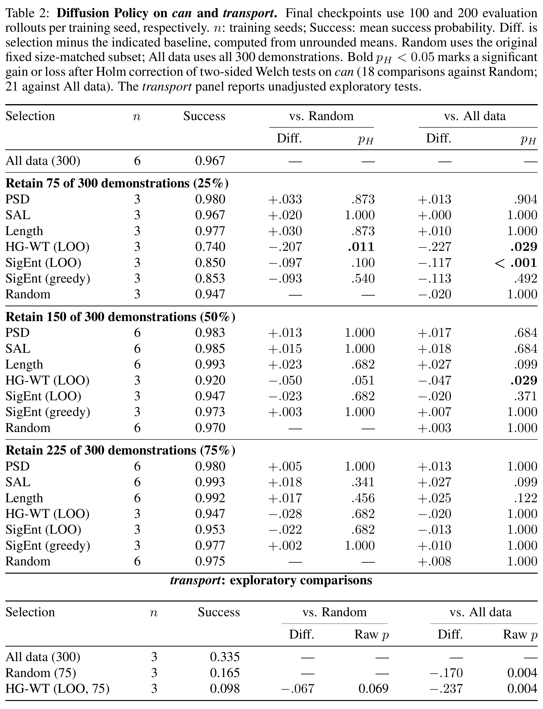
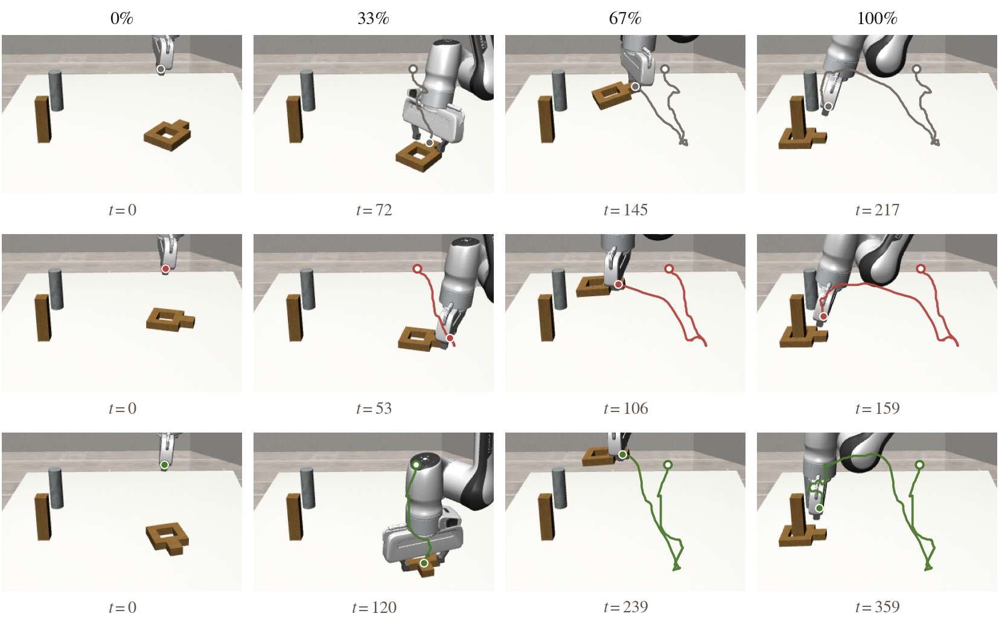

<div align="center">

# CuraEval: Evaluating Demonstration Curation on Mixed-Skill Robot Data

**CoRL 2026 Workshop "Oops, I Erred"**

</div>

<p align="center">
  
</p>

CuraEval tests whether a demonstration-quality score improves imitation
learning on mixed-skill data. Each score selects 25, 50 or 75% of robomimic's
multi-human (MH) demonstrations, and the policy trained on the selection is
compared with a random subset of the same size and with all data. All policies
of a task get the same number of gradient steps, the final checkpoint is
evaluated on a fixed set of initial states, and the comparisons are tested
over training seeds with Holm's correction.

This repository contains the scores, the selection, training and evaluation
scripts for Diffusion Policy and BC-RNN, the comparison statistics, and a port
of CUPID to robomimic's Diffusion Policy.

## Code

| path | contents |
|---|---|
| `curaeval/metrics/` | the demonstration scores |
| `curaeval/data.py` | reading robomimic demonstrations; reading and writing selection masks |
| `curaeval/stats.py` | seed-level intervals, Welch tests, Holm correction |
| `scripts/` | selection masks, training (Diffusion Policy, BC-RNN), log parsing, comparison |
| `cluster/` | Slurm templates for masks, training, evaluation and CUPID scoring |
| `cupid_port/` | CUPID influence scores for robomimic Diffusion Policy checkpoints ([README](cupid_port/README.md)) |
| `tests/` | property tests of the scores |

## Installation

```bash
# scores, masks and statistics (CPU only)
pip install -r requirements/core.txt

# training, evaluation and CUPID (Python 3.10; install a CUDA build of PyTorch 2.x first)
pip install -r requirements/train.txt
```

`pip install -e .` makes `curaeval` importable from anywhere; the scripts also
run from a plain checkout.

## Data

The experiments use robomimic's multi-human low_dim datasets for can, square
and transport, with 300 demonstrations each from operators labelled better,
okay and worse:

```bash
bash scripts/download_data.sh          # -> data/robomimic/<task>/mh/low_dim_v141.hdf5
```

## Scores

| key | name | score | source |
|---|---|---|---|
| `psd` | PSD | total spectral power of the end-effector position | Sojib et al., arXiv:2605.01544 |
| `psdvel` | Velocity-PSD | the same score on end-effector velocity | variant of PSD |
| `sal` | SAL | RINSE spectral arc length | Kulkarni et al., arXiv:2604.23000 |
| `geomloo` | HG-WT (LOO) | leave-one-out contribution to the geometric entropy H_G | Luo et al., arXiv:2606.20871, with our leave-one-out wrapper |
| `faktual` | SigEnt (LOO) | leave-one-out contribution to the signature-kernel entropy | Sirigiri et al., arXiv:2603.11634, entropy term only |
| `hlen` | Length | episode length (shorter is kept) | heuristic |
| `hpath` | Path inefficiency | path length over endpoint distance | heuristic |
| `hjerk` | Jerk | mean squared jerk | heuristic |
| `cupid` | CUPID | performance influence (`cupid_port/`) | Agia et al., arXiv:2506.19121 |

`faktual_greedy` and `geomloo_greedy` select by forward-greedy maximisation of
the two entropies instead of the leave-one-out ranking. Every score is
reimplemented from its paper; the docstrings quote the specification and note
where the adaptation departs from it. Which end of each score is kept was
fixed before any policy was trained.

A score on its own:

```python
from curaeval.data import load_demos
from curaeval.metrics import METRICS

demos, names = load_demos("data/robomimic/square/mh/low_dim_v141.hdf5")
keep = METRICS["hlen"].select(demos, retention=0.5)   # indices of the kept demonstrations
```

## Running the protocol

**1. Selection masks** (CPU, minutes):

```bash
cp cluster/env.example.sh cluster/env.sh      # then set the paths in it
bash cluster/prepare_masks.sh
```

This copies the datasets to a working directory and writes the masks into the
copies as robomimic filter keys (`mask/<key>`): every score of
`curaeval.metrics.METRICS` at 25, 50 and 75% retention, the greedy SigEnt and
HG-WT selections, and random subsets `random_<retention>_s<seed>`. For a
single dataset:

```bash
python scripts/make_masks.py --dataset data_masked/square_mh.hdf5 --retentions 0.25 0.5 0.75 --seeds 0 1 2
python scripts/make_faktual_greedy.py --dataset data_masked/square_mh.hdf5
python scripts/make_geom_greedy.py --dataset data_masked/square_mh.hdf5 --retentions 0.25
```

CUPID masks come from `cupid_port/`.

**2. Training and evaluation** (GPU):

```bash
python cluster/gen_manifest.py --tasks square --out cluster/manifest_square.txt
sbatch --array=0-<N-1>%10 --export=ALL,MANIFEST=cluster/manifest_square.txt cluster/train_dp.slurm

awk '{print "dp_"$1"_"$2"_seed"$3}' cluster/manifest_square.txt > cluster/reeval_square_dp.txt
sbatch --array=0-<N-1>%10 --export=ALL,MANIFEST=cluster/reeval_square_dp.txt cluster/reeval.slurm
```

`cluster/train_bc.slurm` trains BC-RNN instead (run names `bc_<task>_...`).
Without Slurm, `scripts/run_dp.py` and `scripts/run_bc.py` train one policy and
robomimic evaluates its final checkpoint:

```bash
python scripts/run_dp.py --dataset data_masked/square_mh.hdf5 --filter_key hlen_50 \
    --name dp_square_hlen_50_seed1 --output_dir ckpt/dp_square_hlen_50_seed1 \
    --seed 1 --horizon 500 --fast
python -m robomimic.scripts.run_trained_agent --n_rollouts 200 --horizon 500 --seed 424242 \
    --agent $(find ckpt/dp_square_hlen_50_seed1 -name last.pth)
```

**3. Comparison** (CPU):

```bash
python scripts/parse_reeval.py 'logs/reeval_*.log' --tsv runs_square_dp.tsv
python scripts/compare.py runs_square_dp.tsv --out statistics_square_dp.tsv
```

`compare.py` compares every selection with the random subset of the same size
and every subset with all data, using two-sided Welch tests over training seeds
and Holm's correction within each of the two families.

## Hyperparameters

| | Diffusion Policy | BC-RNN |
|---|---|---|
| model | robomimic `diffusion_policy`: CNN U-Net (down dims 256/512/1024, kernel 5), DDPM with 100 training and inference steps, observation/action/prediction horizons 2/8/16, EMA (power 0.75) | robomimic BC-RNN-GMM low_dim recipe: 2-layer LSTM (hidden 400), sequence length 10, GMM action head, no actor MLP, learning rate 1e-4 |
| training | 100 epochs x 500 steps, batch 256; transport 300 epochs | 2000 epochs x 100 steps, batch 100 |
| evaluation | final checkpoint (`last.pth`), evaluator seed 424242, 200 rollouts (100 on can), horizon 400 (can), 500 (square), 700 (transport) | same |
| numerics | TF32 (`--fast`); all runs of one comparison on one GPU type (NVIDIA A40) | same |

The step budget is fixed per task and policy, so every subset gets the same
number of gradient steps whatever its size. Random subsets are
`numpy.random.default_rng(seed).choice(300, k, replace=False)` with
k = round(retention x 300).

Cells trained in the paper (3 or 6 training seeds each):

* Diffusion Policy, square: all data; PSD, SAL, Length, CUPID, HG-WT (LOO),
  SigEnt (LOO) and SigEnt (greedy) at 25/50/75%; Velocity-PSD and Jerk at
  50/75%; random subset 0 at every retention and random subsets 1 and 2 at 25%.
* Diffusion Policy, can: all data; PSD, SAL, Length, HG-WT (LOO), SigEnt (LOO),
  SigEnt (greedy) and random at 25/50/75%.
* Diffusion Policy, transport (300 epochs): all data, and random and HG-WT
  (LOO) at 25%.
* BC-RNN, square: all data; PSD, SAL and Length at 50/75%; HG-WT (LOO) and
  SigEnt (LOO) at 25%; random at 25/50/75%.
* HG-WT (greedy) at 25% on square and can.

One Diffusion Policy run took 1.5 to 2 A40-hours to train and about as long to
evaluate on can and square, and about 9 + 5 hours on transport.

## Results

Diffusion Policy on square, can and transport (Tables 1 and 2 of the paper):

<p align="center">
  
</p>
<p align="center">
  
</p>

Demonstrations kept at 25% retention on square: the median-length
demonstration of a random subset, of Length and of HG-WT (LOO), from top to
bottom; all are successful human demonstrations (Figure 2 of the paper):

<p align="center">
  
</p>

## Tests

```bash
pytest                              # property tests of the scores (CPU, seconds)
python cupid_port/smoke_test.py     # CUPID port end to end (CPU, a few minutes; needs requirements/train.txt)
```

## License

MIT (see `LICENSE`). `cupid_port/` re-implements parts of CUPID and of its
TRAK fork, both MIT-licensed; their notices are in
`cupid_port/THIRD_PARTY_LICENSES.md`. The robomimic datasets are distributed
by the robomimic authors under their own terms.
